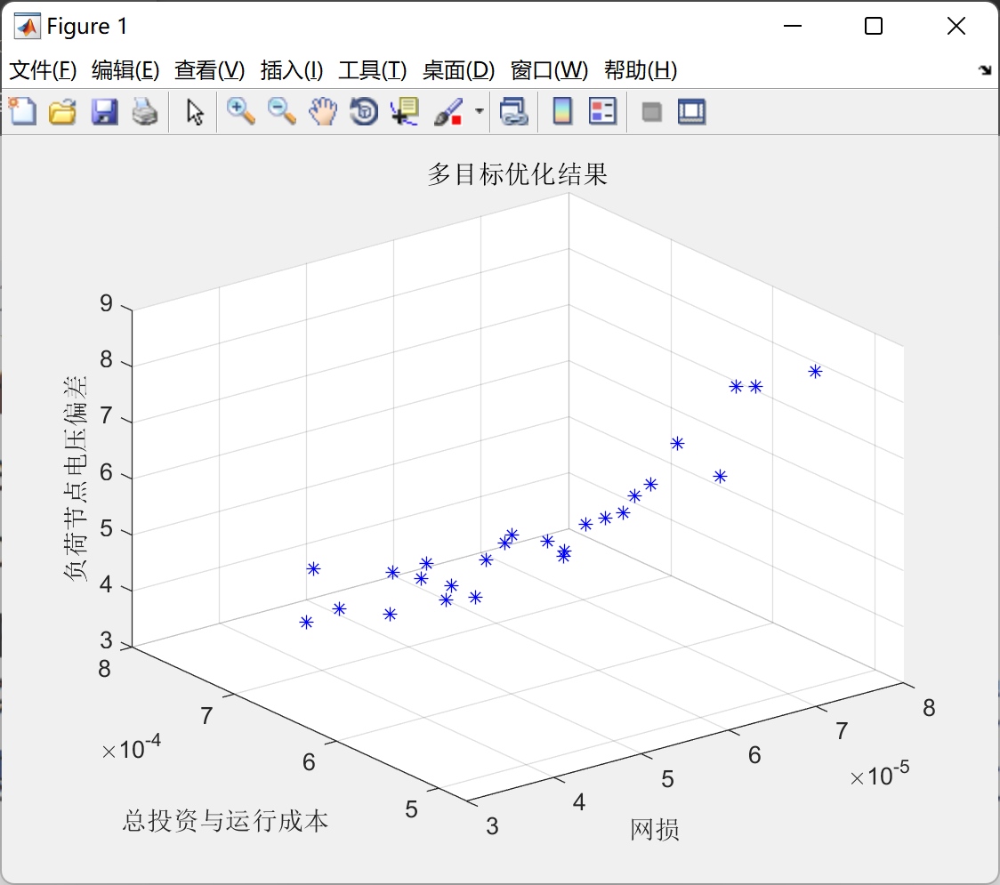

# Application of Multi-Objective Particle Swarm Algorithm in Distributed Power Source Site Selection and Capacity Determination (Matlab Code Implementation)

\n  \n  Run results:
\n  \n

## Images

<!-- PAYMENT_BLOCK -->

## Get this dataset

- Payment link (Stripe): [Buy now](https://buy.stripe.com/3cs8yP7sY87d0vu9AB)
- Payment QR code: 

<!-- /PAYMENT_BLOCK -->
